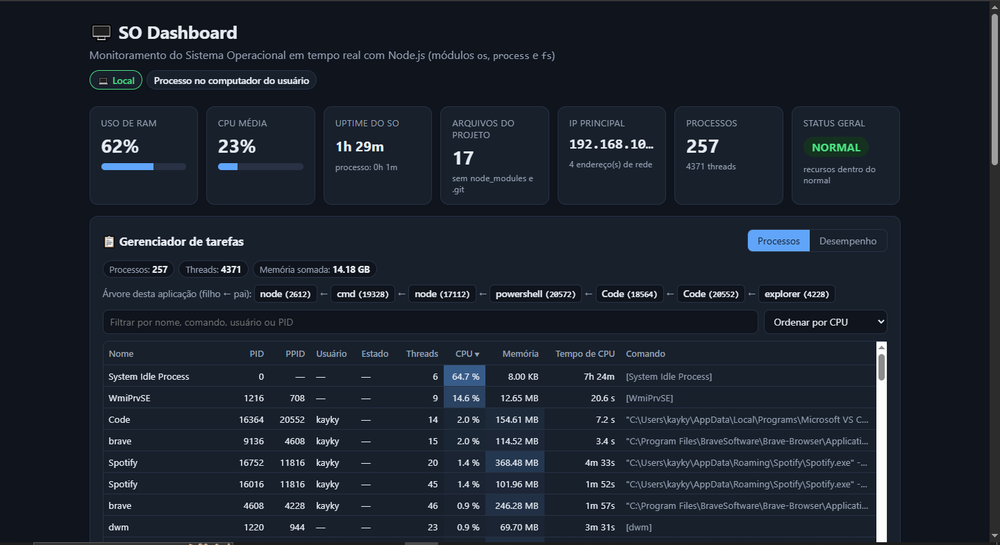
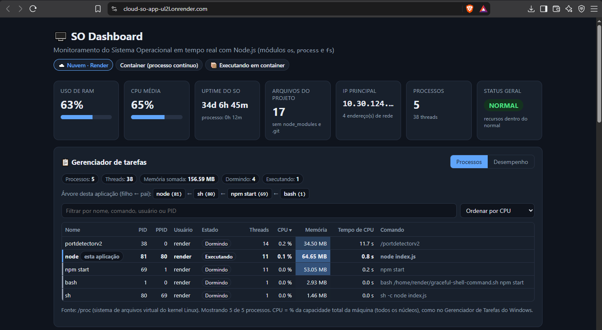
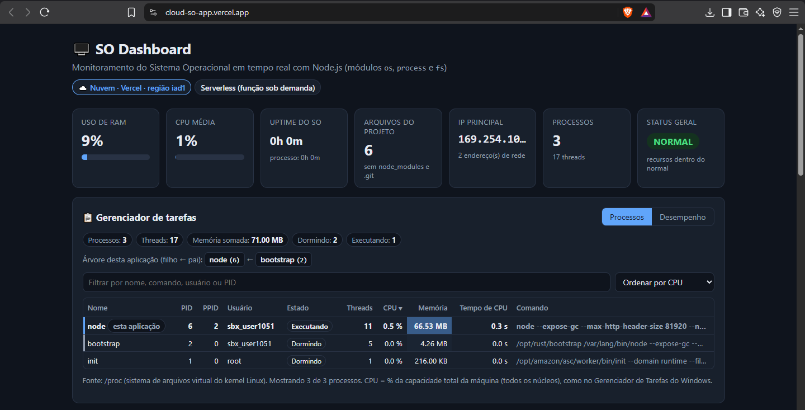
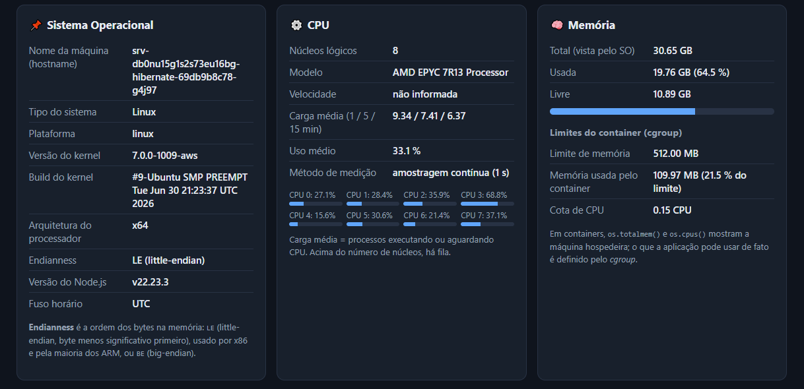
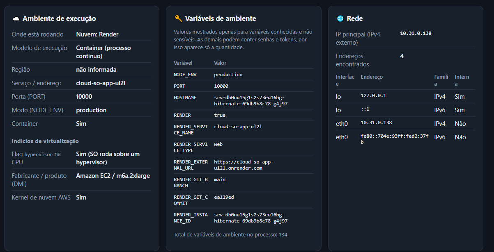
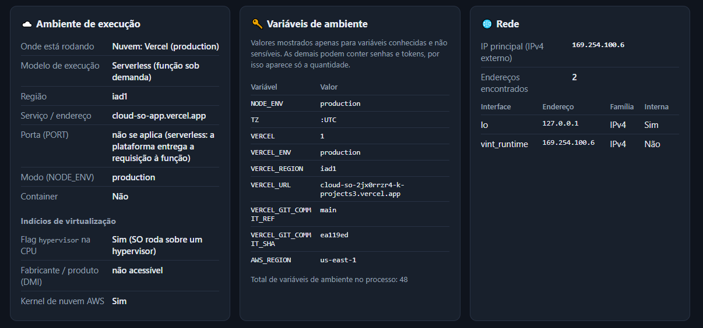
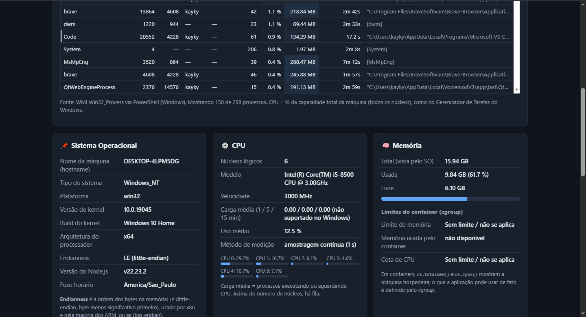
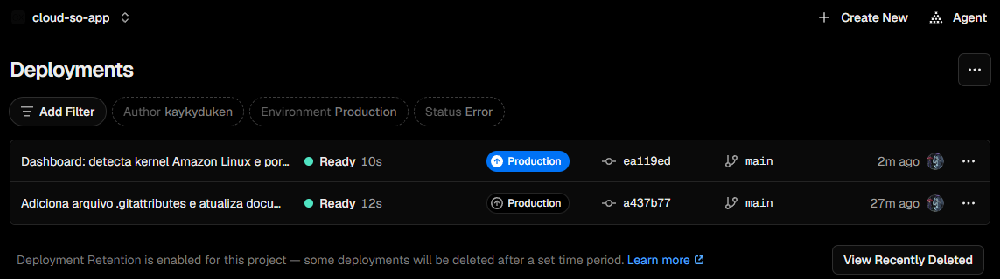

# Relatório comparativo — SO Dashboard: Local × Render × Vercel

**Instituição:** Fatec Itapetininga — Análise e Desenvolvimento de Sistemas (3º ciclo)
**Disciplina:** Sistemas Operacionais — Aula 07 / Tarefa 07
**Professor:** Prof. Me. Deivison S. Takatu
**Aluno:** Kayky Gabriel Silvano Tomé
**Repositório:** https://github.com/Kaykyduken/cloud-so-app
**Aplicação no Render:** https://cloud-so-app-ul2l.onrender.com
**Aplicação na Vercel:** https://cloud-so-app.vercel.app

---

## 1. Objetivo

Evoluir a aplicação `cloud-so-app`, criada na Aula 06 com Node.js e Express, para um **dashboard completo de monitoramento do sistema operacional**, com indicadores visuais de desempenho, informações detalhadas do SO e identificação automática do ambiente de execução. Em seguida, publicar a mesma aplicação em uma segunda plataforma semelhante ao Render — a **Vercel** — e comparar os três ambientes (computador local, Render e Vercel) e as duas ferramentas de hospedagem, relacionando as diferenças com virtualização, infraestrutura remota e serviços sob demanda.

## 2. Evolução do projeto

| Aula 06 (versão inicial) | Aula 07 (esta versão) |
|---|---|
| 4 cartões com dados básicos (SO, CPU, memória, processo) | Painel executivo com 7 indicadores: uso de RAM, CPU média, uptime formatado, arquivos do projeto, IP principal, nº de processos e status geral |
| — | **Status geral** NORMAL / ATENÇÃO / ALTO USO, com o mesmo critério do exemplo da aula (RAM > 65 % ou 85 %; carga média > 70 % ou 100 % dos núcleos) e, em container, o uso do limite do cgroup |
| Hostname, plataforma, arquitetura | Também tipo do sistema, versão e build do kernel, **endianness**, versão do Node.js e fuso horário |
| Selo "Local" ou "Nuvem" | Identificação da plataforma (Render, Vercel, Railway, AWS Lambda, Kubernetes), modelo de execução, região, porta, `NODE_ENV`, variáveis de ambiente (somente as não sensíveis) e indícios de virtualização |
| — | Rede (interfaces e IP principal), arquivos do projeto e usuário do processo (UID/GID, shell, home) |
| — | **Gerenciador de tarefas**: lista os processos visíveis para a aplicação, com PID, PPID, usuário, estado, threads, %CPU, memória e árvore "filho ← pai" da própria aplicação |
| Só processo contínuo | Também funciona como **função serverless** (Vercel): o `index.js` exporta o `app` e mede a CPU sob demanda quando o `setInterval` não roda |



### 2.1 Como o gerenciador de tarefas obtém os processos

O arquivo `processos.js` escolhe a fonte de dados conforme o sistema operacional:

- **Linux** (Render e Vercel): lê o sistema de arquivos virtual **`/proc`**, onde o kernel publica um diretório por processo (`/proc/<PID>/stat`, `status` e `cmdline`).
- **Windows** (local): consulta a classe WMI **`Win32_Process`** pelo PowerShell (`Get-CimInstance`), que informa o processo pai, e usa o `tasklist /v` para descobrir o dono de cada processo.
- O **%CPU** de cada processo é calculado comparando o tempo de CPU acumulado (modo usuário + modo sistema) entre duas leituras, como fazem o `top` e o Gerenciador de Tarefas.

### 2.2 Ajustes feitos durante a atividade

| Situação | Ajuste |
|---|---|
| Migração do computador local de Linux (Nobara) para Windows 10 | Instalação do Node.js 22 pelo `winget`; liberação de scripts no PowerShell (`Set-ExecutionPolicy -Scope CurrentUser RemoteSigned`) para o `npm` funcionar |
| No Windows, o gerenciador não mostrava PPID nem dono dos processos | Troca do `Get-Process` pela consulta WMI `Win32_Process` + `tasklist /v` |
| Arquivos editados no Windows ficavam com quebra de linha CRLF | Criação do `.gitattributes` (`* text=auto eol=lf`) |
| A Vercel aparecia com "Kernel de nuvem AWS: Não" | O kernel da Vercel é Amazon Linux (`amzn2`), e o teste só procurava `aws`; passou a reconhecer os dois |
| A Vercel aparecia com "Porta: 3000 (padrão local)" | Em serverless nenhuma porta é aberta; a página passou a mostrar "não se aplica (serverless)" |
| Render usava Node 24 e o computador local, Node 22 | `"engines": { "node": "22.x" }` no `package.json`; Render e Vercel passaram a usar Node 22 |

## 3. Metodologia

Os dados foram coletados em 13/10/2026 pelo próprio dashboard, nos três ambientes, com a mesma versão do código (commit `ea119ed`). Os tempos de deploy foram obtidos do log do Render e do painel da Vercel; o tempo de carregamento a frio (*cold start*) foi medido quadro a quadro em uma gravação de tela.

| Ambiente | Onde roda | Modelo de execução |
|---|---|---|
| **Local** | Computador pessoal, Windows 10 Home | Processo comum no SO do usuário |
| **Render** | Plano Free, região Oregon (EUA) | Container com processo contínuo (PaaS) |
| **Vercel** | Plano Hobby, região `iad1` (Washington, EUA) | Função serverless, executada sob demanda |

## 4. Indicadores do painel executivo

| Indicador | Local | Render | Vercel |
|---|---|---|---|
| Uso de RAM | 62 % | 63 % | 9 % |
| CPU média | 12 % a 23 % | 33 % a 65 % | 0 % a 2 % |
| Uptime do SO | 1h 29min | 34 dias (depois 103 dias) | 0 a 8 min |
| Arquivos do projeto | 17 | 17 | 6 |
| IP principal | 192.168.10.127 | 10.31.0.138 | 169.254.100.6 |
| Processos visíveis | 257 (4371 threads) | 5 (38 threads) | 3 (17 threads) |
| Status geral | NORMAL | NORMAL | NORMAL |

Os mesmos indicadores dizem coisas diferentes em cada ambiente. Localmente, RAM e CPU refletem todos os programas abertos no computador. No Render, refletem a **máquina hospedeira inteira**, compartilhada com outros clientes, e não a aplicação (que usava 0,1 % de CPU). Na Vercel, refletem uma **microVM pequena e exclusiva**, criada há poucos minutos, por isso os valores são baixos.





## 5. Sistema operacional e hardware

| Informação | Local | Render | Vercel |
|---|---|---|---|
| Hostname | DESKTOP-4LPM5DG | srv-db0nu15g1s2s73eu16bg-hibernate-… | 169.254.x.x (mudava entre leituras) |
| Tipo / plataforma | Windows_NT / win32 | Linux / linux | Linux / linux |
| Kernel | 10.0.19045 (Windows 10 Home) | 7.0.0-1009-aws (Ubuntu) | 5.10.255-…amzn2 (Amazon Linux 2) |
| Arquitetura / endianness | x64 / LE | x64 / LE | x64 / LE |
| Processador | Intel Core i5-8500 @ 3,00 GHz | AMD EPYC 7R13 | Intel Xeon @ 2,90 GHz |
| Núcleos lógicos | 6 | 8 | 2 |
| Frequência | 3000 MHz | não informada | não informada |
| Carga média (1/5/15 min) | não existe no Windows | 9,34 / 7,41 / 6,37 | 0 / 0 / 0 |
| Memória vista pelo SO | 15,94 GB | 30,65 GB | 2,23 GB |
| Limite real (cgroup) | sem limite | **512 MB e 0,15 CPU** | nenhum visível |
| Fabricante / produto (DMI) | não acessível | **Amazon EC2 / m6a.2xlarge** | não acessível |
| Flag `hypervisor` na CPU | Não | Sim | Sim |
| Node.js | v22.23.2 | v22.23.3 | v22.23.2 |



Pontos de destaque:

- **Mesma arquitetura, SOs diferentes.** Os três ambientes são x64 little-endian, por isso o mesmo código JavaScript roda sem alteração. Mas são três sistemas: Windows NT, Ubuntu preparado para a AWS e Amazon Linux.
- **Recursos visíveis × recursos disponíveis.** No Render, o container enxerga 8 CPUs e 30,65 GB porque o módulo `os` consulta o kernel do hospedeiro; o limite real (512 MB e 0,15 CPU) é imposto pelos **cgroups** e só aparece em `/sys/fs/cgroup`. O próprio Render usa a cota, e não as 8 CPUs, para dimensionar a aplicação: o log de deploy mostra `WEB_CONCURRENCY=1` "com base nas CPUs disponíveis na instância".
- **Hospedeiro sobrecarregado.** A carga média de 9,34 em 8 núcleos indica fila de processos esperando CPU no servidor do Render, enquanto a aplicação estava praticamente ociosa. É o efeito do hardware compartilhado (*multi-tenant*).
- **A AWS por trás das duas plataformas.** O DMI do Render identifica uma instância **Amazon EC2 m6a.2xlarge** (8 vCPUs AMD EPYC). A Vercel roda em um kernel Amazon Linux na região AWS `us-east-1`. As duas plataformas são camadas de serviço construídas sobre a infraestrutura da AWS.
- **Carga média só no Linux.** O Windows não implementa o conceito de *load average*, por isso o `os.loadavg()` retorna zeros localmente. Na Vercel também é zero, porque a microVM só executa a aplicação.

## 6. Ambiente de execução e variáveis de ambiente

| Informação | Local | Render | Vercel |
|---|---|---|---|
| Identificação | Local | Nuvem: Render | Nuvem: Vercel (production) |
| Modelo | Processo no computador do usuário | Container (processo contínuo) | Serverless (função sob demanda) |
| Porta | 3000 (padrão do código) | 10000 (definida pela plataforma em `PORT`) | não se aplica |
| `NODE_ENV` | não definido (development) | production | production |
| Container detectado | Não | Sim | Não |
| Variáveis de ambiente | 78, nenhuma de nuvem | 134 (`RENDER`, `RENDER_SERVICE_NAME`, `RENDER_EXTERNAL_URL`, `RENDER_GIT_COMMIT`…) | 48 (`VERCEL`, `VERCEL_ENV`, `VERCEL_REGION`, `VERCEL_URL`, `AWS_REGION`…) |
| Usuário do processo | kayky (sem UID/GID no Windows) | render, UID 1000, shell `/bin/bash` | sbx_user1051, UID 993, shell `/sbin/nologin` |
| Diretório da aplicação | C:\Users\kayky\…\cloud-so-app | /opt/render/project/src | /var/task |
| Rede | Wi-Fi, IP da rede doméstica | `eth0` com IP privado | `vint_runtime` com IP *link-local* (169.254.x.x) |





A identificação automática funciona pelas **variáveis de ambiente que cada plataforma injeta no processo**: a presença de `RENDER` ou de `VERCEL` revela onde a aplicação está. O dashboard mostra o valor só de variáveis conhecidas e não sensíveis; das demais, mostra apenas a quantidade, porque podem conter senhas e tokens.

A **porta** mostra a diferença entre os modelos: localmente o código escolhe a 3000; no Render a plataforma define a 10000 e um processo próprio (`portdetectorv2`) espera a aplicação abri-la; na Vercel nenhuma porta é aberta, porque a plataforma importa o `app` e entrega cada requisição diretamente à função.

Nos dois provedores a aplicação roda com um **usuário sem privilégios**, isolado do sistema: no Render um usuário comum, e na Vercel um usuário de *sandbox* sem shell de login.

## 7. Processos (gerenciador de tarefas)

| | Local (Windows) | Render | Vercel |
|---|---|---|---|
| Fonte | WMI `Win32_Process` | `/proc` | `/proc` |
| Processos visíveis | 257 | 5 | 3 |
| Árvore da aplicação | node (2612) ← cmd ← node/npm ← powershell ← Code ← Code ← explorer | node (81) ← sh (80) ← npm start (69) ← bash (1) | node (6) ← bootstrap (2) |
| Processo PID 1 | — (no Windows: System Idle = 0, System = 4) | `bash` com o script de inicialização do Render | `init` do runtime da AWS |
| Outros processos | navegador, VS Code, Spotify, serviços do Windows… | `portdetectorv2` (detecta a porta da aplicação) | nenhum |



- **Isolamento por namespace de PIDs.** No Render e na Vercel, a aplicação só enxerga os processos do próprio container ou microVM, numerados a partir de 1. Os processos de outros clientes do mesmo servidor ficam invisíveis.
- **Hierarquia pai e filho.** No Render, a árvore mostra exatamente o caminho de inicialização: o script da plataforma (`bash`) executa o `npm start`, que abre um shell (`sh -c node index.js`), que cria o processo `node`. No Windows, o `npm` inicia o Node por meio do `cmd`, e a árvore sobe até o VS Code e o Explorer.
- **Medir também consome recursos.** No Windows, o processo `WmiPrvSE` chegou a 14,6 % de CPU: é o serviço que responde às consultas WMI que o próprio gerenciador de tarefas faz a cada 3 segundos. Observar o sistema altera o sistema.

## 8. Deploy e ciclo de vida

### 8.1 Tempo de deploy (commit `ea119ed`)

| Etapa | Render | Vercel |
|---|---|---|
| Clone + preparação do Node 22 | ~3 s | — |
| Build (`npm install`) e envio | ~3,5 s | — |
| **Build total** | **~6,5 s** | **10–12 s** |
| Criação do container até `npm start` | ~9 s | não existe |
| Aplicação abre a porta | +3 s | não existe |
| Verificação de saúde ("live") | +9 s | não existe |
| **Total, do push ao ar** | **~29 s** | **~28 s** |



O tempo total foi praticamente igual, mas distribuído de forma diferente. No Render, o build é rápido e a maior parte do tempo vai para **criar o container, iniciar o processo e verificar se ele responde**. Na Vercel, o build é mais longo, mas não há processo para iniciar: a função só é executada quando chega uma requisição.

### 8.2 Instâncias e cold start

- **Vercel: várias instâncias descartáveis.** Durante a coleta, leituras seguidas da mesma página vieram de microVMs diferentes (hostnames 169.254.7.39, 169.254.52.237, 169.254.25.129 e 169.254.35.55), cada uma com seu próprio uptime. A plataforma cria instâncias conforme a demanda e distribui as requisições entre elas. O painel registrou **379 execuções da função** em 6 horas: cada atualização do dashboard é uma execução.
- **Cold start na Vercel medido: ~1,5 s.** Depois de mais de 1 hora sem acesso, a página abriu com o processo tendo **6 segundos de vida** e o SO recém-iniciado (uptime 0 min), e os dados apareceram cerca de 1,5 s após o clique.
- **Render: hibernação recria o container inteiro.** O plano Free desliga o serviço após 15 minutos sem acessos, e o próprio painel avisa que isso "pode atrasar requisições em 50 segundos ou mais". Entre a coleta das 18:27 e o teste das 19:40, o serviço foi recriado às 19:34 (log: `Running 'npm start'` às 22:34 UTC), sem acesso do aluno — provavelmente por um acesso automático à URL pública. Ele voltou em **outro servidor**: o nome do pod mudou (`…g4j97` → `…h7wwq`), o uptime do hospedeiro passou de 34 para 103 dias e até o kernel mudou (7.0.0-1009-aws → 6.8.0-1057-aws). Pelo log, o Node abriu a porta só **1,9 s** após o `npm start`: a maior parte do atraso de uma retomada é a criação do container, e não a inicialização da aplicação.
- **Local: o processo vive enquanto o terminal estiver aberto.** O PID só muda quando o servidor é reiniciado manualmente.

## 9. Comparação entre as ferramentas: Render × Vercel

| Critério | Render (plano Free) | Vercel (plano Hobby) |
|---|---|---|
| Modelo de serviço | PaaS com **container** e processo contínuo | PaaS **serverless**: funções executadas sob demanda |
| Como a aplicação roda | `npm start` mantém o servidor Express ligado e escutando a porta | A plataforma importa o `app` exportado e o executa a cada requisição |
| Configuração para Express | Build `npm install` e start `npm start` | Detectou Express automaticamente; nenhuma configuração |
| Arquivos estáticos (`public/`) | Servidos pelo próprio Express | Servidos pela CDN da Vercel |
| Infraestrutura observada | Ubuntu sobre Amazon EC2 m6a.2xlarge, container com cgroup de 512 MB e 0,15 CPU | Amazon Linux em microVM de 2 vCPUs e 2,23 GB, região AWS us-east-1 |
| Processo | Um processo de longa duração | Instâncias curtas, várias em paralelo |
| Ociosidade | Hiberna após 15 min; retomada pode passar de 50 s | Instâncias são descartadas; nova instância em ~1,5 s |
| Escalabilidade | Uma instância no plano gratuito | Automática, por instância (horizontal) |
| Estado em memória | Mantido enquanto o processo vive | Não garantido entre requisições |
| Deploy contínuo | A cada push na `main` (~29 s) | A cada push na `main` (~28 s), com *preview* por branch |
| Versão do Node | Lida do `engines` do `package.json` | Lida do `engines` (aviso "Node.js Version Override") |
| Logs e métricas | Eventos, logs do deploy e da aplicação | Deployments, logs, invocações de função, requisições de CDN |
| Indicado para | APIs e servidores que precisam ficar ligados (WebSocket, tarefas em segundo plano) | Sites e APIs com requisições curtas e tráfego variável |

**Vantagens e limitações observadas.** O Render se comporta como um servidor tradicional: o processo é contínuo, o `setInterval` de medição de CPU roda sem interrupção e o container pode guardar estado, mas no plano gratuito ele hiberna e a retomada é lenta. A Vercel responde rápido mesmo a frio e escala sozinha, mas cada instância é descartável; por isso a aplicação precisou medir a CPU "na hora" quando não havia amostragem contínua, e não pode depender de dados guardados em memória.

## 10. Relação com os conceitos da disciplina

### 10.1 Virtualização

```
Local:   Hardware (i5-8500) → Windows 10 → processo node

Render:  Servidor físico AMD EPYC (AWS) → Hypervisor (EC2 m6a.2xlarge)
         → Ubuntu (kernel -aws) → Container (cgroup: 512 MB / 0,15 CPU) → node

Vercel:  Servidor físico Intel Xeon (AWS) → Hypervisor
         → microVM com Amazon Linux (2 vCPUs, 2,23 GB) → node
```

A flag `hypervisor` na CPU confirmou máquina virtual nos dois provedores, e não no computador local. O Render combina **máquina virtual + container**: o container compartilha o kernel do hospedeiro e é isolado por namespaces e cgroups. A Vercel usa **uma microVM por instância**, com kernel próprio, o que explica o uptime do SO zerado a cada nova instância.

### 10.2 Infraestrutura remota

Nas duas plataformas, o desenvolvedor não tem acesso ao servidor: só envia o código pelo GitHub. Todos os dados de hardware vieram da própria aplicação. Mesmo assim, foi possível identificar o provedor (AWS), o tipo de instância, a região e o kernel, mostrando que a nuvem é uma camada de abstração sobre data centers reais.

### 10.3 Serviços sob demanda (modelo NIST)

| Característica | Onde apareceu |
|---|---|
| Autoatendimento sob demanda | Os dois serviços foram criados pelo painel, importando o repositório, sem contato com o provedor |
| Amplo acesso à rede | Aplicação acessível de qualquer navegador pelas URLs públicas |
| Pool de recursos | Hospedeiro do Render compartilhado (carga 9,34 em 8 núcleos) e processos de outros clientes invisíveis |
| Elasticidade | Vercel criando várias instâncias conforme as requisições; Render desligando e recriando o serviço |
| Serviço mensurável | Limites do plano (512 MB, 0,15 CPU) e métricas da Vercel (379 invocações, 381 requisições de CDN) |

## 11. Conclusão

A mesma aplicação, com o mesmo código, rodou em três ambientes muito diferentes, e o próprio dashboard mostrou essas diferenças. Localmente, ela é um processo entre 257, com acesso a todo o hardware. No Render, é um processo de longa duração dentro de um container limitado a 512 MB e 0,15 CPU, sobre uma máquina virtual da AWS compartilhada e sobrecarregada. Na Vercel, é uma função executada em microVMs pequenas e descartáveis, criadas em cerca de 1,5 s.

A comparação entre as ferramentas mostra que não existe uma opção melhor em tudo. O Render oferece o modelo de servidor tradicional, adequado a aplicações que precisam ficar ligadas, mas o plano gratuito sofre com a hibernação. A Vercel oferece escalabilidade automática e respostas rápidas mesmo a frio, ao custo de não manter processo nem estado entre requisições.

Por fim, o trabalho reforçou que a nuvem é construída sobre conceitos de Sistemas Operacionais: processos e sua hierarquia, escalonamento e cotas de CPU, gerenciamento e limites de memória, namespaces, cgroups e virtualização. Os indicadores que um SO informa (CPUs, memória, uptime) precisam ser interpretados conforme a camada em que a aplicação está rodando.

## 12. Referências

- TANENBAUM, A. S.; BOS, H. *Sistemas Operacionais Modernos*. 4. ed. São Paulo: Pearson, 2016.
- SILBERSCHATZ, A.; GALVIN, P. B.; GAGNE, G. *Fundamentos de Sistemas Operacionais*. 9. ed. Rio de Janeiro: LTC, 2015.
- MELL, P.; GRANCE, T. *The NIST Definition of Cloud Computing* (SP 800-145). NIST, 2011.
- NODE.JS. *OS module* e *Process*. Disponível em: https://nodejs.org/api/os.html
- RENDER. *Documentation*. Disponível em: https://render.com/docs
- VERCEL. *Documentation — Account Plans* e *Express on Vercel*. Disponível em: https://vercel.com/docs
- MICROSOFT. *Win32_Process class*. Disponível em: https://learn.microsoft.com/windows/win32/cimwin32prov/win32-process
- TAKATU, D. S. *Exemplo Express SO Avançado*. Disponível em: https://github.com/deivisontakatu/exemplo-express-so-avancado
- TAKATU, D. S. *Aula 07 — Dashboard de monitoramento*. Fatec, 2026.

---

**Anexos:** prints em [`prints/`](prints), log do deploy em [`logs/`](logs) e anotações brutas da coleta em [`dados-coletados.md`](dados-coletados.md).
